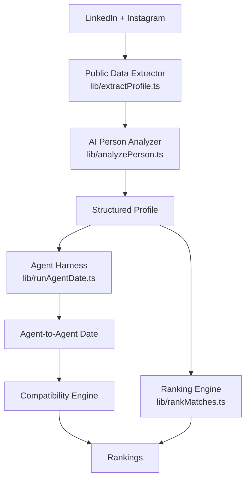

# AgentDate

**Your agent dates before you do.** AgentDate builds an AI agent for a person from two public sources only — their public LinkedIn profile and public Instagram profile — lets agents go on simulated first dates, and ranks the strongest connections.

## How it works

1. Paste a LinkedIn URL and a public Instagram URL.
2. The extractor reads only publicly visible metadata from those two URLs.
3. An LLM turns that text into a structured profile (every inference carries a source label and confidence).
4. Open any profile, watch two agents date live (6 turns, streamed), then see a compatibility evaluation.
5. `/rankings/[id]` ranks every other person using structured fields, with LLM-written one-line explanations for the top matches.

25 **fictional, synthetic demo personas** are seeded in `data/people.json` so the demo works immediately. They are clearly badged as demo personas and have no real links. Replace them with verified people by editing `scripts/generate-seed.mjs` (or the JSON directly).

## Architecture



## Tech stack

Next.js 16 (App Router) · TypeScript · Tailwind CSS v4 · Zod · Anthropic or OpenAI (plain `fetch`, no SDK) · optional Playwright.

## Setup & running locally

```bash
npm install
cp .env.example .env.local   # add a key
npm run dev                  # http://localhost:3000
npm run build                # production build
```

### Environment variables

| Variable | Purpose |
| --- | --- |
| `ANTHROPIC_API_KEY` | Use Anthropic (preferred if both set). Model via `ANTHROPIC_MODEL` (default `claude-sonnet-5-5`). |
| `OPENAI_API_KEY` | Use OpenAI. Model via `OPENAI_MODEL` (default `gpt-4o-mini`). |
| `ENABLE_PLAYWRIGHT` | `1` to render pages with Playwright when plain fetch yields nothing (requires `npm i playwright` + browsers; not suited to Vercel serverless). |

With **no key**, the app runs in *offline simulation mode*: seeded profiles, rankings and template-based dates work, and the UI says so. New-user analysis returns an explicit "no LLM configured" profile rather than inventing anything.

## Public profile extraction

`lib/extractProfile.ts` makes logged-out requests to only the URLs you supply (host-validated to `linkedin.com` / `instagram.com`). It reads Open Graph/meta tags and JSON-LD: LinkedIn name, headline, about/description; Instagram display name, bio, metadata and any captions present in the public HTML. It never logs in, uses cookies, solves CAPTCHAs, or bypasses login walls. LinkedIn and Instagram frequently block anonymous access; when that happens the result is `status: "limited"` with the `extractedFields` that were retrieved, and the UI shows: *"We could only retrieve limited public information from this profile."* Missing data is never invented. Check each platform's terms before using this at scale.

## Agent dating architecture

`lib/runAgentDate.ts`: each agent gets the system instruction *"You represent this person during a simulated first date. You know only the information in their LinkedIn and Instagram-derived profile. Be curious and conversational. Do not invent private facts."* plus both structured profiles (never raw page text). Agents alternate 6 turns via `/api/date`, which streams NDJSON so the UI shows "thinking / responding" live. A separate evaluator call (Zod-validated JSON) produces score, shared interests, strengths, friction, natural topics and "meet again?".

## Ranking algorithm

`lib/rankMatches.ts` scores pairs without any LLM call:

| Component | Weight |
| --- | --- |
| Shared interests (interests + hobbies) | 30% |
| Values similarity | 25% |
| Lifestyle compatibility | 20% |
| Conversation compatibility (topics vs. the other's interests) | 15% |
| Complementary traits (compatibility signals vs. the other's energizers/values) | 10% |

Each component is a normalized token-overlap score in 0–1 (`matches / √(|A|·|B|)`); the weighted sum is mapped to a 42–97% display score. The top 5 get LLM-written one-sentence explanations (`/api/explain`).

## Privacy & limitations

- Only public pages; no authentication; no scraping behind login walls.
- Inferences are tentative and labeled with source + confidence. The analyzer is instructed never to infer religion, race, ethnicity, sexual orientation, health, or political affiliation, and a keyword filter drops such items as a backstop.
- No database: custom agents and cached dates live in the visitor's `localStorage`. Profile text is sent to your LLM provider for analysis.
- Extraction often returns limited data; results are entertainment-grade, not facts about a person. Only build agents for yourself or with consent.

## Deployment (Vercel)

1. Push to GitHub and import in Vercel (framework auto-detected).
2. Add `ANTHROPIC_API_KEY` or `OPENAI_API_KEY` in Project → Settings → Environment Variables.
3. Deploy. API routes use `maxDuration = 60` (date runs ~7 sequential LLM calls).
